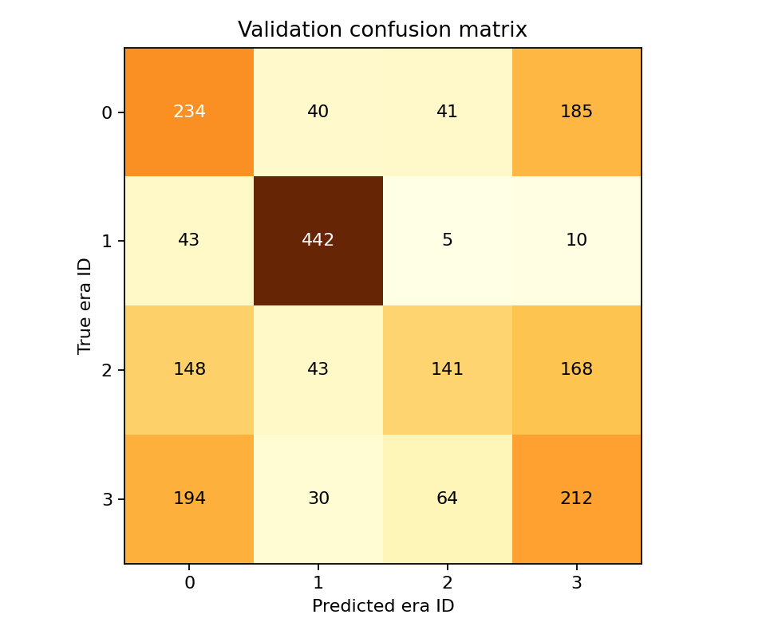

# شطر — تقرير النتائج

## المشكلة والهدف
مساعدة القارئ على استكشاف العصر الأقرب لنص شعري، ومساعدة الكاتب على إكمال شطره الأول.

## المنهج
البيانات من Ashaar. استُخدمت الأزواج التي جرى تجهيزها ومراجعتها في الدفتر الأول. أُعيد التقسيم مرة واحدة لمعالجة ضعف تمثيل الشعراء، دون اختيار البذرة بناءً على درجات النماذج. التقسيم الجديد يفصل الشعراء داخل كل عصر. تُزال تكرارات الأشطر بين الأقسام، وتؤخذ عينات تراعي تنوع الشعراء. تغيّر مجموعة التحقق يعني أن المقارنة بالتجربة القديمة ليست مقارنة ثابتة البيانات.

## نتائج التحقق

| النموذج | Accuracy | Macro-F1 |
|---|---:|---:|
| TF-IDF + Logistic Regression | 38.45% | 37.90% |
| AraBERT | 42.00% | 42.50% |
| AraPoemBERT | 51.45% | 50.65% |

### نتائج كل عصر — AraBERT

| العصر | Precision | Recall | F1 |
|---|---:|---:|---:|
| العصر الأندلسي | 31.24% | 34.80% | 32.92% |
| العصر الجاهلي | 72.77% | 62.00% | 66.95% |
| العصر الحديث | 35.69% | 41.40% | 38.33% |
| العصر العثماني | 34.10% | 29.80% | 31.80% |

### نتائج كل عصر — AraPoemBERT

| العصر | Precision | Recall | F1 |
|---|---:|---:|---:|
| العصر الأندلسي | 37.80% | 46.80% | 41.82% |
| العصر الجاهلي | 79.64% | 88.40% | 83.79% |
| العصر الحديث | 56.18% | 28.20% | 37.55% |
| العصر العثماني | 36.87% | 42.40% | 39.44% |

المصنف المعتمد للواجهة: **faisalq/bert-base-arapoembert** وفق Macro-F1 على أمثلة التحقق نفسها.

ترتيب معرّفات العصور في الرسم:
- 0: العصر الأندلسي
- 1: العصر الجاهلي
- 2: العصر الحديث
- 3: العصر العثماني



## توزيع البيانات

```text
           era  examples  poets      split
العصر الأندلسي     12218      9      train
 العصر الجاهلي      3057     69      train
  العصر الحديث     36447     50      train
العصر العثماني     16969     13      train
العصر الأندلسي      2506      3 validation
 العصر الجاهلي       884     15 validation
  العصر الحديث      8593     10 validation
العصر العثماني      3098      3 validation
العصر الأندلسي      7122      3       test
 العصر الجاهلي       765     15       test
  العصر الحديث      7648     10       test
العصر العثماني      2719      3       test
```

## تقييم شطر
ملف shatr_compare.csv يعرض التكملات قبل التدريب وبعده. ملف human_eval_validation.csv مخصص لتقييم أعمى من ١ إلى ٥ للغة والمعنى والطابع الشعري وغياب التكرار. ملف human_eval_key_validation.csv يكشف ترتيب النسخ ويحتفظ به المنسق بعيدًا عن المقيم. لا تُعد خسارة النموذج دليلًا على صحة الوزن أو جودة الشعر.

## الاختبار النهائي
شغّلوا final test بعد تثبيت القرارات. الأرقام أعلاه تخص validation فقط.

حالة مقارنة التوليد: لم تُنفذ مقارنة التوليد بعد.
حالة التقييم البشري: لا توجد درجات بشرية ملخصة لهذه النسخة.
لم يُنفذ الاختبار النهائي بعد.

## القيود
التصنيف بين أربع فئات لا يثبت تاريخ النص. قد تؤثر قلة الشعراء وتداخل الأغراض الأدبية وقصر النص وجودة التسميات في الأداء. النموذج الأساسي قد يعرف قصائد مشهورة من تدريبه المسبق. النسخة الحالية لا تتحقق آليًا من العروض أو القافية، ولا تضمن أصالة التكملات.

## المصادر
- https://huggingface.co/datasets/arbml/ashaar
- https://huggingface.co/aubmindlab/bert-base-arabertv02
- https://huggingface.co/Qwen/Qwen3-0.6B
- https://huggingface.co/faisalq/bert-base-arapoembert